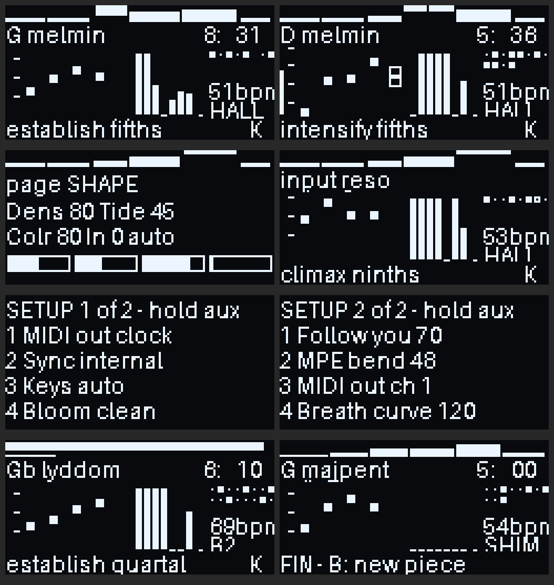
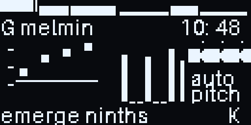

# Amble

**Amble** is a generative ambient composer for the Critter & Guitari **Organelle M**, written in Pure Data.
It composes whole pieces of 5 to 30 minutes with a form, or drifts endlessly as a backing track.
It is built to play with live input: MPE / breath controllers such as the Lekholm DM48X, keyboards,
acoustic instruments, voice, samples and field recordings.

> **Status:** in development, delivered in three stages.
> 1. **Done:** form, rhythm, Bloom reverb.
> 2. **Done:** live MIDI (MPE, breath) and audio listening.
> 3. **Done:** the graphical OLED score, the SETUP page, and MIDI clock in and out.
>
> It builds, and passes its offline tests in Pure Data. It has not been run on an Organelle yet.

## Install

Copy `patches/Amble` into the Organelle's `Patches` folder. It needs Organelle OS 5 (Pd 0.53) and uses
vanilla Pd objects only. How to play it: [`patches/Amble/README.txt`](patches/Amble/README.txt).

**Demos:** `python3 tools/render_demo.py` renders example pieces as MP3s into `demos/` (not kept in the
repository).

## How it composes

| | |
|---|---|
| **Piece** | A seed picks the key and scale (16, including just, harmonic-7th, slendro and pelog), voicing families, the pad synthesis palette, tempo (40 to 72 BPM by default; SETUP can choose 24 to 140), meter (3 to 7), motif, textures and reverb. A new seed is used at every start; a seed replays its piece. |
| **Form** | One of 5 archetypes (arch, slow build, waves, two peaks, journey) over 6 to 12 sections. Each section has a role: emerge, establish, develop, intensify, climax, break, return or dissolve. Roles set the layers, the key area (out from home and back), tempo, harmonic pace, drone pulse, motif transformation (inverted, raised, restored) and reverb. The return section replays the opening progression. |
| **Harmony** | Voice-led chords from 8 voicing families. Each voice glides on its own delay, so chords dissolve into each other. |
| **Rhythm** | One clock at 24 ticks a beat. Each layer has its own relation to it, so the texture has rhythm without a beat. |

The layers and their rhythms:

| Layer | Rhythm |
|---|---|
| Drone | a pulse locked to the bar |
| Pads | breathing cycles of 7, 9, 11 and 13 half-bars, which phase against each other |
| Motion | Euclidean patterns, with swing and tempo echoes |
| Bells | free phrasing, in beats |
| Textures | random weather |
| Cloud | grains, locked to the beat in intense sections |

## Live input

- **MIDI:** MPE notes, per-note bend (48 semitones; 2 on channel 1) and breath (CC 2, CC 11, channel or poly
  pressure) play 4 live voices in the piece's synthesis type. With a breath controller, breath sets the
  voices' level and brightness.
- **The Organelle keys** play notes when Amble is standalone. When an external controller plays, they
  become function keys; aux + key is a function at any time.
- **Start / Stop** (A#, top octave): Stop fades out and freezes the piece where it is; Start goes on from there.
  An incoming MIDI Start / Stop does the same when Sync is set to follow clock. **Freeze** (the reverb tail and
  the cloud) is aux + F# with an external controller, or aux + F# twice quickly standalone.
- **Listening:**
  - A held or sung pitch pulls the next chord to contain it.
  - A note held for 6 s becomes the key centre.
  - Breath raises the energy, and a section waits while you play (up to 3 × 30 s).
- **Audio:**
  - **Clean-up:** a gate and automatic gain.
  - **Pitch:** a pitch tracker built from vanilla objects (FFT autocorrelation; reads a 220 Hz sine as MIDI 57.06).
  - **Class:** pitched, plucked or texture, from pitch confidence, onset rate and level.
  - **Auto mode:** chooses chord strings, harmonised grains, bells on attacks or tuned bands to suit.
  - **Memories:** up to 4 × 8 s captured from your input, brought back transformed in break, return and dissolve sections.

## The screen and SETUP

The OLED is a live score. The images below are rendered offline by `tools/shots.py` with an OLED
emulator, so the font only approximates the Organelle's.





| Screen | Contents |
|---|---|
| **Score** | The form strip (one bar per section, height = energy, current one inverted, a playhead). Key and scale, with the time left. The pad voices gliding on a pitch ladder, with your held notes as boxes and a breath bar. Meters for every layer, the reverb and the input. The motion layer's Euclidean pattern with a moving cursor, the tempo and the reverb type. The section role and voicing, and K/M/E tags for who is playing and the clock. |
| **Input** | While external audio plays, the right-hand column becomes an input panel: the last 6 s of the input as a waveform with its onsets ticked above, the input mode, and what Amble hears (pitch, pluck, texture), with a dot while it records a memory. A sung or played pitch is drawn as a line across the pitch ladder, so you see it against the pad voices. The rhythm column comes back 5 s after the input stops. |
| **Knob page** | Shown for 6 s after you turn a knob or tap aux. |
| **SETUP** | Hold aux for 1 s; aux taps turn the 7 pages. Page 1: MIDI out (off, tempo only, tempo + notes, notes only), Sync (internal or follow clock), Keys (auto, play, functions), Bloom (clean or vintage). Page 2: how much the chords follow you, MPE bend range, MIDI out channel, breath curve. Page 3: output, width, pan motion, tempo range. Page 4: which MIDI notes go out, arp octave, the CPU load, the CPU guard (on or off). Page 5, **SOUNDS**: pad type, drone, texture and character, each auto or your choice (see below). Page 6, **MUSIC**: key, scale, chord voicing (auto or fixed) and the bar pulse. Page 7, **MIDI IN**: where notes go, what breath does, which CC is breath, the breath level. Saved in `settings.txt` with the knob values (except In, which always starts at 0). |

**SOUNDS** (SETUP page 5) lets you choose the sounds yourself, mid-piece, to audition them. Each item is **auto** (the piece chooses, as before) or your choice, applied at once (crossfaded) and kept for every later section:
- **Pads:** auto; **raw** (the dry, buzzy types of the first demos: vox, partials, fold and pulsar, with no character effect); or one type for all four pad voices (fm, vox, bow, part, fold, pulsr, saws, pwm, digi, sync, tine).
- **Drone:** auto, pure, analog, organ, fm.
- **Texture:** auto, rain, wind, ember, chirp, radio, data, buzz.
- **Character:** auto, clean, chorus, tape, ring, crush.

**MUSIC** (SETUP page 6): **Key** (auto or C to B), **Scale** (auto or one of the 16) and **Chords** (auto or one voicing) apply at once with a chord change; a fixed choice stays (no modulation or scale change). **Pulse** (off, gentle, normal, strong) sets how much the drone and sub swell on every bar.

**MIDI IN** (SETUP page 7):
- **Notes to:** what MIDI notes and the Organelle keys play. **voice** (the live voice, as before); **chords** (the notes you hold are the pad chord; the composer waits until you let go); **drone** (the drone and sub move to your note); **bells** (a bell per note); **cloud** (each held note tunes a grain stream). The notes still steer the harmony.
- **Breath to:** **voice+piece** (as before: the live voice's level and tone, and the piece's density), **voice**, **density**, **brightness**, **reverb** (the reverb sends) or **swell** (the whole level, like an expression pedal). Ten seconds without breath and it lets go.
- **Breath CC:** 2 + 11 (default), 2, 11, 1 (mod wheel), 74, or touch only. Channel and poly pressure always count.
- **Breath in:** the breath level arriving now, to check your controller.

**MIDI out** (SETUP page 1): off, **tempo only** (clock), **tempo + notes**, or **notes only**.
- **Clock:** 24 ticks a beat at the piece's tempo (following the form's tempo changes), with Start and Stop
  at the start and end of a piece.
- **Notes**, so external synths and arpeggiators follow the composition. Each part has its own channel,
  counted from the MIDI out channel (wrapping after 16):

  | Channel | Part |
  |---|---|
  | base | the chord as Amble voices it (4 notes, wide), held until the next change |
  | base + 1 | the tonic, held while the key stays |
  | base + 2 | the bells (the motif), short notes |
  | base + 3 | the motion layer's Euclidean arpeggio, short notes |
  | base + 4 | the bass: the sub's note (the pedal or the chord root), held |
  | base + 5 | the **arp chord**: the same chord in close position within an octave from its root, starting at the Arp octave (C1 to C5, default C3), held until the next change. Point an arpeggiator here. |

  Chord and bass velocities follow the piece's energy. Notes are rounded to the nearest semitone (just,
  harmonic-7th, slendro and pelog scales come out as the nearest 12-tone notes).
- **MIDI notes** (SETUP page 4): all; harmony (the chords, tonic and bass, no bells or motion); or arp only
  (just the arp chord).

**Sync:** Amble leads, or it follows an incoming clock. Incoming ticks drive its rhythm and Start resets the bar.

## Sounds

| | Choices (each piece picks its own) |
|---|---|
| **Pads** | 11 types (most stereo inside): fm, vox formants, bowed string, drifting partials, wavefolder, pulsar, **saws** (detuned analog ensemble through a tracking resonant low-pass), **pwm** (Juno-like), **digi** (ring mod, bit crush, sample-rate reduction), **sync** (hard-sync sweep), **tine** (an electric-piano bell that strikes itself). A piece uses a palette of 3, per voice and per section, weighted towards the electronic and bell-like types (about 80 % of picks). |
| **Drone** | 4 designs: pure, analog (saws and a square through a slow resonant sweep), organ (drawbars with a rotary shimmer), fm (an electric growl). The break may switch to the piece's second design. |
| **Sub** | A dedicated layer: the pedal an octave under the tonic, the chord root as a bass line, or both. Softly saturated, so small speakers still hear it. |
| **Character** | On the pads: clean, chorus, tape (wow, saturation, hiss that follows the music), ring modulation, or crush. |
| **Atmospheres** | In about half the pieces, mostly in the emerge, break and dissolve sections: haze (air shimmering on the chord), deep (rumble with distant thunder), space (air ringing in combs tuned to the chord), night (distant insects), tides (waves washing across the field). All stereo. |
| **Textures** | 7: rain, wind, embers, chirps, radio (soft drifting static and whistles), data (blip bursts), buzz (electric hum on the tonic). |
| **Input** | Besides chord strings, cloud, tape, ghost and tuned bands: **vocode** (a 10-band vocoder; your sound speaks through a synth choir singing the chord) and **morph** (it speaks through the pads themselves). Auto mode vocodes pitched input in some pieces. |

The four random streams are seeded through a hash, so nearby seeds don't share their sound choices. The
tests check that 10 consecutive seeds give 10 different palettes.

## Stereo

Amble is wide by default and keeps moving:
- **The bass:** the sub and the bass stay centred, for a solid low end and good mono.
- **Drone:** the twin and the interval orbit in opposite directions, and two breath tubes drift on their own cycles.
- **Pads:** each voice has its own home (8 / 36 / 64 / 92 %) and orbits around it on a slow cycle. The cycles differ, so the voices phase against each other.
- **Cloud and bells:** each grain and each bell note lands in its own place.
- **Motion:** the arpeggio sweeps across the field.
- **Width by section:** mid/side width follows the section role, narrower as a piece emerges and widest at the climax.

Measured on rendered pieces:
- side vs middle about −5 to −10 dB
- correlation near 0 above 200 Hz
- about 2 dB of slow left–right movement
- a mono sum costs only about 1 dB

**Stereo scenes (the composition places the voices):** each section picks a scene that sets where the
pads live, where bells and motion play, and how far the cloud spreads:
- **spread:** across the field
- **split:** pads left, bells and motion right
- **center:** a focused core with a wide halo
- **circle:** everything orbits wide
- **mirror:** voices in mirrored pairs

The choice depends on the section's role. The pads glide to their new places over 6 s.

**Stereo inside the pad types:** detuned saws on different sides, PWM with mirrored widths, opposite vowels, partials
alternating left and right, offset formants, and bell partials fanned around each note. Every type is
mono-safe: a mono sum dips by at most about 5 dB, never cancels.

**SETUP page 3:**
- **Output:** stereo wide; mono for mono rigs and external effects; or split: two mono stems, the harmony bed
  (pads with their character, drone, sub) on the left and everything else on the right. Each side carries one side
  of the reverb.
- **Width:** 50 to 150 %.
- **Pan motion:** how far the voices travel.
- **Tempo:** the range a piece picks its tempo from: ambient 40-72 (default), slow 24-48, wide 30-110,
  pulse 60-100, fast 90-140. Above 84 BPM the slow layers (pad breathing, bells, the drone's bar swell) feel
  the beat at half speed and the arpeggio counts in 8ths, so a fast piece still breathes. A change takes effect
  at once, keeping the piece's place in the range. With Sync = follow clock any tempo comes from outside.

## Reverb

- **Bloom 1 / Bloom 2:** after the Alesis MidiVerb II *Bloom* programs (45 and 49).
  - **Where it comes from:** ported from [Conduit](https://github.com/sydilaxe/Trimui-Conduit-dev)'s `bloom.c`, which follows thement's [midiverb_emulator](https://github.com/thement/midiverb_emulator) analysis.
  - **How it sounds:** a damped loop through 15 diffusing all-passes makes the sound swell for about half a second before it rings out.
  - **How it runs:** at 22.05 kHz, close to the unit's 23.4 kHz.
  - **How close it is:** the tests compare it with the C version (`tools/ref`). The swell peak is within 0.02 s, T60 within 3 %, and the envelope correlates at r ≈ 0.9.
- **Hall:** an 8-line FDN.
- **Shimmer:** the Hall with an octave-up shifter in its loop.
- **Level:** the Mix knob (SPACE) sets the reverb return. At its default the reverb sits about 6 dB under the dry
  sound, at 100 % about level with it.
- **Sends:** two knob pages set each group's reverb send from off (dry) to full; 50 % is the designed balance.
  SENDS 1: drone (and sub), pads (and the notes you play), bells, motion. SENDS 2: textures, cloud, atmosphere,
  input. For example: a dry drone under reverberant pads.
- **Auto:** the piece chooses. Each section change blooms the reverb up, the climax lengthens it, and the dissolve darkens it.

CPU, measured offline: about 3 % of one x86 core with every layer, an atmosphere, the vocoder, a character effect,
4 live voices, the OLED and the clock running. That should be roughly 25 to 30 % of the Organelle's CM3.

## Source (`tools/`)

The patch is **generated** by Python, so it can be rebuilt and tested. Edit the generator, not the `.pd`
files.

- `gen.py` builds `patches/Amble`.
- `pdlib.py` writes Pd files. It also has a small step language that compiles to `[expr]` chains.
- `gen_brain.py`: piece, form, sections, chord changes, clock and motion, reverb control.
- `gen_live.py`: MIDI in, live voices, listening, audio analysis and class, memories.
- `gen_ui.py`: knobs, keys, screen.
- `gen_dsp.py`: voices, layers, input, master.
- `gen_sounds.py`: the electric pad types, drone designs, sub, electric textures, character effects and vocoder.
- `gen_oled.py`: the OLED score.
- `gen_setup.py`: SETUP, settings, MIDI clock and notes out, clock in.
- `gen_verb.py`: the reverbs.
- `data.py`: the tables.
- `harness.py` runs the patch offline (`pd -batch`).
- `ci_check.py` is the test suite (115 checks).
- `shots.py` renders OLED screenshots with `oledemu.py`.
- `ref/` holds Conduit's Bloom in C, the reference for the reverb tests.

```
cd tools
./build.sh            # regenerate the patch
python3 ci_check.py   # offline checks in Pure Data (needs gcc for the Bloom reference)
```

Requirements: Python 3 with numpy and scipy, Pure Data 0.53+, gcc, and ffmpeg for the demos.

## CPU

The Organelle-M runs Amble on one core, so a few things keep it from crackling:

- **Only what sounds runs.** Every layer, pad voice and live voice switches its DSP off when silent. The
  pitch tracker runs only while the In knob is up. In always starts at 0 when Amble loads.
- **Half rate where it can't be heard:** the Bloom and Hall/Shimmer reverbs, the vocoder and the pitch tracker
  run at 22.05 kHz (their content stays below 11 kHz).
- **No long ticks.** A new piece, a new section and a chord change are split into stages a few milliseconds
  apart, so no single scheduler tick runs long enough to make the audio drop out (the longest went from about
  0.9 ms to under 0.2 ms on a desktop core).
- **A bigger audio buffer.** The Organelle OS starts Pd with a 6 ms audio buffer, so any moment where Pd needs
  longer than that drops out as a crackle, even at a low average load. Amble's `pd-opts.txt` (which the OS appends
  to Pd's options) asks for 25 ms instead: room for brief spikes, at the cost of about 19 ms more delay when you
  play live. Edit the number in `patches/Amble/pd-opts.txt` (on the Organelle: `Patches/Amble/pd-opts.txt`) to
  trade one for the other.
- **CPU guard.** Amble measures its own load each second (CPU time over logical time). Above 78 % it gets
  lighter in steps: 1, cloud and atmosphere off; 2, textures and the pad character off; 3, the automatic
  vocoder off. Below 50 % for 20 s it steps back. The pads, drone, sub, bells, motion and reverb never change.
  SETUP page 4 shows the load and the guard's level, and can turn the guard off.

## Releases

`.github/workflows/release.yml` builds, checks the committed patch is up to date, runs the tests and
packages `Amble-<version>.zip`. Push a tag `v*`, or run the workflow by hand (Actions → Release build →
Run workflow, with a version such as `v0.1`), to publish a GitHub Release with the zip attached. The
version `dev` makes a pre-release that is replaced each time. The zip goes on a Release rather than a
workflow artifact, so it doesn't use the Actions storage quota.

**The manual** (`Amble-manual-<version>.pdf`, attached to each Release and inside the patch folder) is built by
`tools/manual.py` at every build, from the same source as the patch: knob pages, function keys, SETUP items,
scales, sound types, input modes, tempo ranges and MIDI channels are read from the generator. A control added
without a description in `manual.py` stops the build. Build it locally with `python3 tools/manual.py dev out.pdf`
(needs reportlab and Pillow).

## Licence

GPL-3.0 (see `LICENSE`), as is Conduit, whose Bloom reverb Amble ports.
